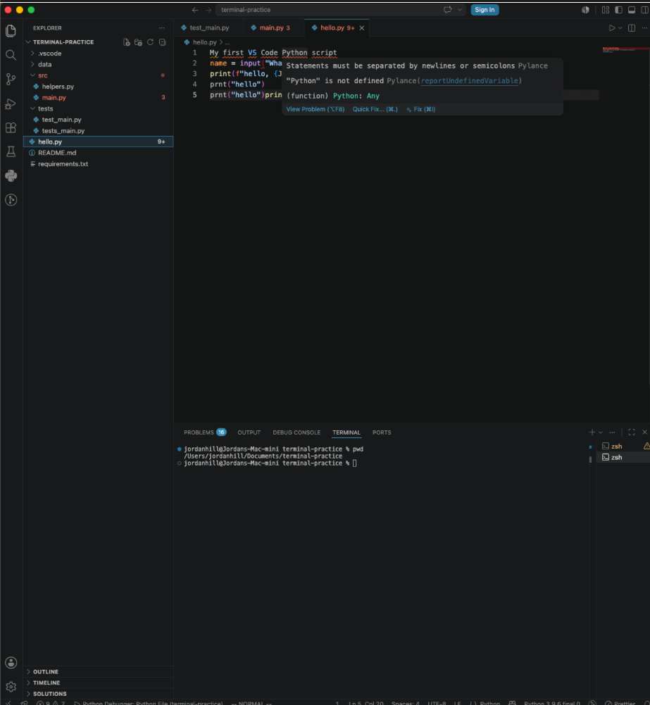

# Development Environment Setup Guide

## VS Code Extensions

The following extensions were installed to improve my development environment and support different programming workflows.

- **Pylance:** Provides advanced IntelliSense, type information, and Python language support. It helps identify potential errors and makes writing Python code more efficient.

- **GitLens:** Enhances Git integration in VS Code by providing repository history, code authorship information, and visual tools for understanding changes. This makes it easier to navigate and manage version-controlled projects.

- **Prettier:** Automatically formats supported code files according to consistent styling rules. It improves readability and reduces time spent manually adjusting formatting.

- **Material Icon Theme:** Provides customizable icons for files and folders in VS Code. These visual indicators make it easier to recognize file types and navigate project structures.

- **Jupyter:** Adds support for interactive notebooks, allowing code execution in individual cells. It is particularly useful for Python experiments, data analysis, and debugging.

- **Python Visual:** Provides visual representations of Python data, including tables and charts. These features can help with inspecting and understanding program output.

## VS Code Environment Screenshot

The screenshot below shows my configured VS Code environment,
including the project file explorer, integrated terminal,
and Python source code with syntax highlighting.



## Terminal Command Cheat Sheet

These ten commands are useful for navigating directories, managing files, and troubleshooting projects from the terminal.

| Command | Description                                       | Example                      |
| ------- | ------------------------------------------------- | ---------------------------- |
| `pwd`   | Displays the current working directory.           | `pwd`                        |
| `ls`    | Lists files and folders in the current directory. | `ls -la`                     |
| `cd`    | Changes the current directory.                    | `cd ~/Documents`             |
| `mkdir` | Creates a new directory.                          | `mkdir package-practice`     |
| `touch` | Creates an empty file or updates its timestamp.   | `touch main.py`              |
| `mv`    | Moves or renames a file or directory.             | `mv old_name.py new_name.py` |
| `cp`    | Copies a file to another location or filename.    | `cp main.py backup.py`       |
| `cat`   | Displays the contents of a text file.             | `cat requirements.txt`       |
| `rm`    | Removes a file.                                   | `rm old_file.txt`            |
| `grep`  | Searches files for matching text.                 | `grep "error" log.txt`       |

These commands provide a foundation for navigating projects, organizing files, and inspecting code without relying entirely on graphical tools.

## VS Code Settings Configuration

The following `settings.json` configuration was used during my initial development environment setup:

```json
{
  "files.autoSave": "afterDelay",
  "editor.formatOnSave": true,
  "editor.wordWrap": "on",
  "editor.fontSize": 14,
  "gitlens.ai.model": "gitkraken",
  "gitlens.ai.gitkraken.model": "gemini:gemini-2.5-flash"
}
```

### Settings Explained

- **`files.autoSave`:** Automatically saves changes after a short delay. This reduces the chance of losing unsaved work.

- **`editor.formatOnSave`:** Automatically formats code when a file is saved, using the configured formatter, such as Prettier. This helps maintain consistent code formatting.

- **`editor.wordWrap`:** Wraps long lines within the editor window, reducing the need for horizontal scrolling.

- **`editor.fontSize`:** Sets the editor's font size to 14 pixels for readability.

- **`gitlens.ai.model`:** Configures GitLens to use GitKraken's AI integration for supported AI-assisted Git features.

- **`gitlens.ai.gitkraken.model`:** Specifies Gemini 2.5 Flash as the selected model for GitLens AI features through GitKraken.

These settings improve readability, consistency, and workflow efficiency while working with Python and other programming languages.

## Troubleshooting: Python Syntax Error in VS Code

**1. What went wrong**

During my early Python practice, I encountered a syntax error in my `hello.py` file. One of my `print()` statements was missing a closing quotation mark. VS Code highlighted the problem, indicating that Python could not interpret the statement correctly.

**2. What I tried first**

My first troubleshooting step was to examine the highlighted line and compare it with the other working `print()` statements in the file. I checked the quotation marks and parentheses to identify any missing characters.

**3. How I identified the solution**

The syntax highlighting helped me narrow down the issue. A properly written print statement needs matching quotation marks around the text and correctly paired parentheses. The corrected statement was:

```python
print("hello")
```

This is the correction I would use to resolve the syntax error.

**4. What I learned**

This example reinforced the importance of checking small syntax details before making larger changes. Even a missing quotation mark can prevent a Python program from running. I also learned how useful VS Code's syntax highlighting and error indicators are for identifying problems. Going forward, I can use these tools alongside terminal error messages to troubleshoot more efficiently.

## Personal Reflection: Understanding My Development Environment

Before starting Coding Temple, I primarily viewed my computer as a tool for running applications, organizing files, and completing everyday tasks. I understood how to navigate folders and install programs, but I had limited knowledge of how development environments worked behind the scenes.

During my first week, I began understanding how files, directories, programming languages, and development tools interact. Learning terminal commands was particularly useful because it showed me how to navigate and manage my computer without relying entirely on a graphical interface. Commands like `cd`, `ls`, and `mkdir` helped me understand how projects are organized and accessed through the command line.

Working with VS Code also changed my perspective. I learned that an editor is more than a place to type code. Extensions, syntax highlighting, integrated terminals, and configuration settings can all contribute to a more efficient development process. I also started recognizing how small syntax errors can affect an entire program and how development tools help identify those mistakes.

What surprised me most was how much control developers have over their working environments. Features I previously took for granted, such as automatic saving and code formatting, can be customized to support different workflows.

Overall, this experience helped me begin thinking less like someone simply using software and more like someone learning to build it. I now have a stronger foundation for organizing projects, troubleshooting problems, and becoming more independent as a developer.
